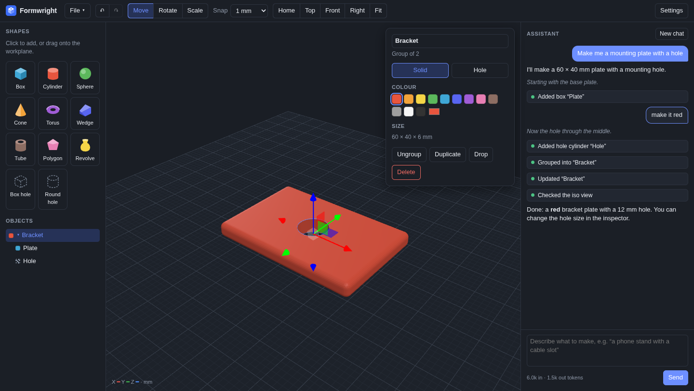

# Formwright

Simple, open-source CAD with an AI assistant you can talk to.

Build with shapes and holes, like Tinkercad, or describe what you want and watch the assistant build it one part at a time. You can type while it works to change course ("make it taller", "no, put the hole on the side"), press Stop, or grab any part and edit it yourself. The assistant always works from the current scene, so your edits are kept.



## Features

- **Shapes:** box (with rounded edges), cylinder, cone, sphere, torus, wedge, tube, polygon extrusion, revolve (lathe profile).
- **Holes and groups:** mark any shape as a hole, then group it with solids to cut it out. Groups nest, move and rotate as one object.
- **Direct editing:** move, rotate and scale gizmo with snapping, exact numbers in the inspector, arrow-key nudging, undo and redo.
- **Assistant:** Claude, or a free local model through Ollama. It streams progress notes, shows each step as a clickable chip, takes interjections between steps, checks its own work by looking at rendered views, and makes every step undoable.
- **Export:** STL for 3D printing and OBJ. Scenes save as `.formwright` (JSON).
- **Desktop app** for Linux, Windows and macOS that updates itself from GitHub releases.

## Install

Download the latest build from [Releases](https://github.com/GPTmadeit/formwright/releases/latest): `.AppImage` or `.deb` for Linux, `-setup.exe` or `.msi` for Windows, `.dmg` for macOS on Apple Silicon. Installed copies check for updates on launch and offer a one-click update.

## The assistant

Open **Settings** and choose how the assistant runs:

- **Claude (Anthropic API):** the best results. Paste an API key from [console.anthropic.com](https://console.anthropic.com/) and pick a model and effort level. The key is stored only on your computer, in your user config directory, readable only by you. Anthropic bills your account for usage.
- **Local model (free):** runs on your own machine through [Ollama](https://ollama.com). Install Ollama, run `ollama pull qwen3-coder` (or pull any model with tool calling), and enter the model name. It's slower and less precise than Claude, and it can't look at renders to check its work, but it costs nothing and nothing leaves your computer. Pointing it at another machine's Ollama (`http://<host>:11434`) also works.

Everything except the assistant works with neither.

## Shortcuts

| Key | Action |
| --- | --- |
| W / E / R | Move / rotate / scale |
| Arrows, PgUp/PgDn | Nudge 1 mm (Shift: 10 mm) |
| D | Drop to workplane |
| H | Toggle solid/hole |
| F | Fit view to selection |
| Ctrl G / Ctrl Shift G | Group / ungroup |
| Ctrl D | Duplicate |
| Ctrl Z / Ctrl Shift Z | Undo / redo |
| Ctrl S / Ctrl O | Save / open |
| Del | Delete |

## Develop

```sh
npm install
npm run dev          # browser at http://localhost:1420
npm run tauri dev    # desktop app
npm test             # model, geometry kernel and AI tool tests
npm run test:ui      # end-to-end in headless Chromium against a scripted mock API (no key, no cost)
```

Layout:

- `src/model`: scene document (shapes, groups, undo history) and transforms
- `src/geom`: geometry kernel on [Manifold](https://github.com/elalish/manifold) (WASM), plus STL/OBJ export
- `src/view`: three.js viewport, selection and gizmo
- `src/ai`: assistant loop (streaming, tool calls, interjections) and the modelling tools it can use
- `src/ui`: palette, object tree, inspector, chat panel
- `src-tauri`: desktop shell (settings storage, file dialogs, updater)

Releases: bump the version in `package.json`, `src-tauri/Cargo.toml` and `src-tauri/tauri.conf.json`, push to `main`, wait for CI to pass, then push a `vX.Y.Z` tag. CI builds and signs the installers and publishes them, along with the `latest.json` the in-app updater reads.

## License

MIT or Apache-2.0, at your option.
